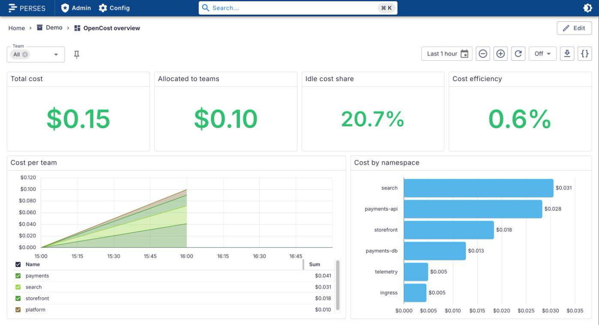
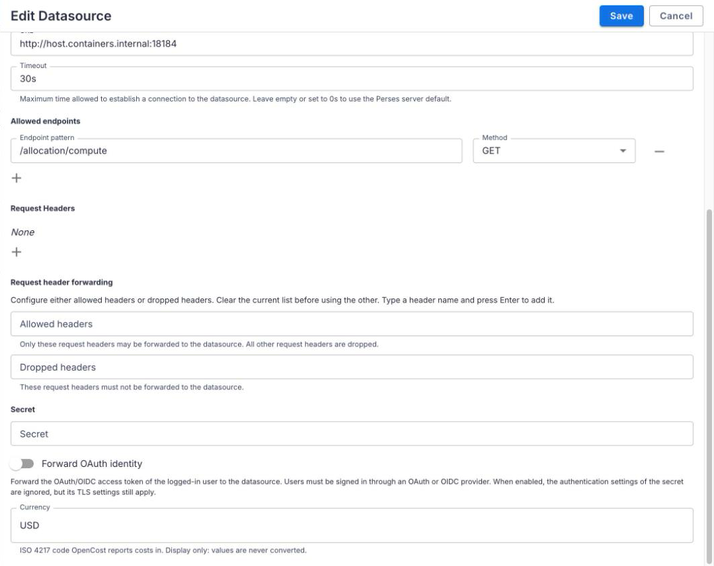
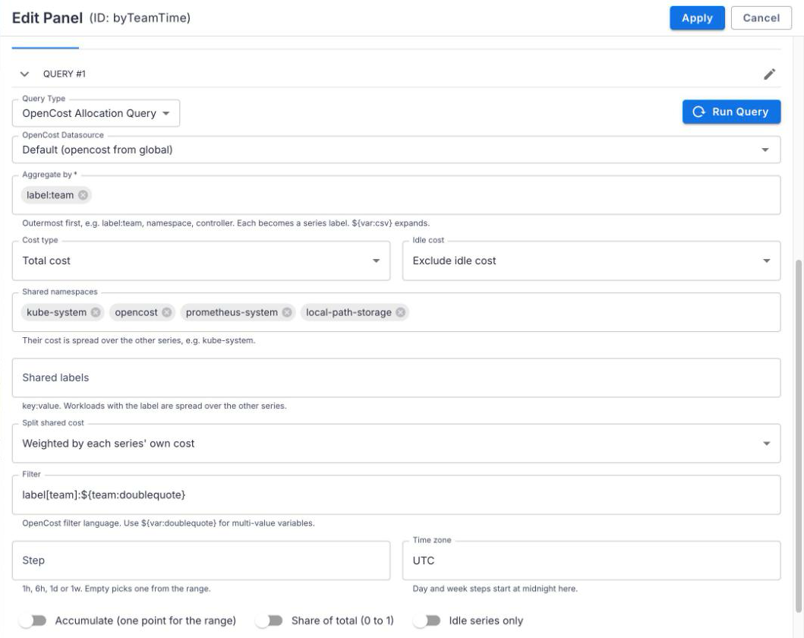
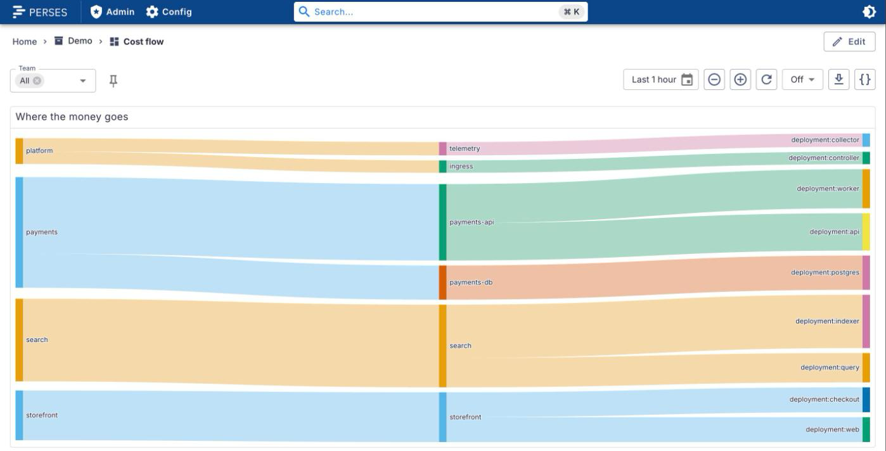
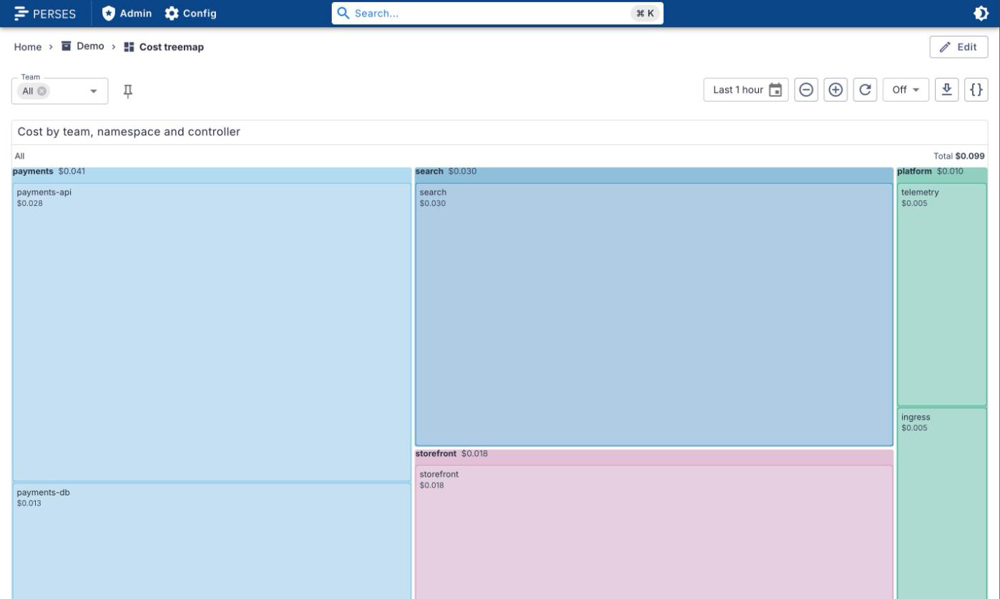

# perses-plugin-opencost

[Perses](https://perses.dev) plugins for [OpenCost](https://opencost.io): a datasource for the
OpenCost API, a query that turns its allocation data into time series, and a variable that lists
teams, namespaces or any other aggregation. Cost per team, namespace or workload, with idle and
shared cost handled, in the panels Perses already has and in Sankey and treemap panels.

<picture>
  <source media="(prefers-color-scheme: dark)" srcset="docs/images/overview-dark.png">
  
</picture>

| Kind                        | Type            | Does                                                                 |
| --------------------------- | --------------- | -------------------------------------------------------------------- |
| `OpenCostDatasource`        | Datasource      | The OpenCost API, direct or through the Perses proxy                 |
| `OpenCostAllocationQuery`   | TimeSeriesQuery | Cost from `/allocation/compute`, one series per team, namespace, ... |
| `OpenCostAggregateVariable` | Variable        | The keys of an aggregation (team names, namespaces, ...) as values   |

## Supported versions

| Plugin | Perses  | OpenCost                                              |
| ------ | ------- | ----------------------------------------------------- |
| 0.1.x  | v0.55.x | v1.113.0 or later; tested with 1.121.4 (chart 2.5.34) |

Built against `@perses-dev/*` 0.55 and `percli` v0.55.1, and tested with Perses v0.55.1.

## When to use this, and when Prometheus

OpenCost also exports metrics to Prometheus (`node_total_hourly_cost`, `container_cpu_allocation`,
`pv_hourly_cost`, ...). They answer different questions.

Use **this datasource** when you want the numbers OpenCost itself reports:

- cost per team, namespace, controller or label, with **idle cost** and **shared cost**
  (kube-system, monitoring, a platform team) handled for you;
- **calendar days and weeks** in your time zone, and totals for the whole range (`accumulate`);
- cost efficiency, and figures that match the OpenCost API (the integration test checks this).

Use **Prometheus** when you want your own cost model in PromQL, to join cost with other metrics
(cost per request, per tenant from your own labels), to alert on cost, or to keep data longer than
OpenCost does. You then rebuild idle and shared cost yourself, and pod-level figures only roughly
match OpenCost's allocation.

## What it does

### OpenCostDatasource

Where the API is: `directUrl` (the browser calls OpenCost), or `proxy` (Perses calls it; the only
path to allow is `GET /allocation/compute`). `currency` is the ISO 4217 code OpenCost bills in; it
labels the numbers and converts nothing. Set the panel's unit to the same code in lower case
(`usd`, `eur`).

<picture>
  <source media="(prefers-color-scheme: dark)" srcset="docs/images/datasource-editor-dark.png">
  
</picture>

### OpenCostAllocationQuery

One series per aggregate key, with a label per dimension: `aggregate: [label:team, namespace]` gives
series with `team` and `namespace` labels, which is what a Sankey or treemap panel groups by.

- **Aggregate** by any of `cluster`, `node`, `namespace`, `controllerKind`, `controller`, `service`,
  `pod`, `container` and `label:<name>`, in any order.
- **Cost type**: `totalCost` (default), `cpuCost`, `ramCost`, `pvCost`, `networkCost`, `gpuCost`, or
  `efficiency` (usage over requests, weighted by CPU and RAM cost; 0 to 1).
- **Idle cost**: `exclude` (default), `include` as its own `__idle__` series, or `share` over the
  workloads in proportion to their cost.
- **Shared cost**: the cost of `sharedNamespaces` and of workloads with `sharedLabels`
  (`team:platform`) is handed to the other series, `weighted` by their cost (default) or `even`.
  OpenCost OSS no longer does this on the API, so the plugin does, per step; the total stays the
  same.
- **Time**: `accumulate` gives one point for the whole time range (stat, bar, Sankey, treemap).
  Otherwise one point per step: `step` (`1h`, `6h`, `1d`, `1w`; at least an hour) or, when unset,
  a step that fits the panel. Day and week steps start at midnight in `timeZone` (default UTC), so
  a day is a calendar day, DST days included.
- **Filter**: the OpenCost filter language, e.g. `namespace:"payments-api","payments-db"` or
  `label[team]:${team:doublequote}`.
- **Share of total** (`fractionOfTotal`): each point as a fraction of its step's total.
  **Idle only** (`idleOnly`): only the `__idle__` series. Together they give the idle cost share.
- Variables work in every text field. A multi-value variable becomes several aggregates or
  namespaces with `${var:csv}`.

<picture>
  <source media="(prefers-color-scheme: dark)" srcset="docs/images/query-editor-dark.png">
  
</picture>

### OpenCostAggregateVariable

The keys of one aggregation over the dashboard's time range, sorted, without `__idle__` and
`__unallocated__`: `aggregate: label:team` lists the teams, `namespace` the namespaces. `filter`
narrows it and may use other variables.

### Spec

```yaml
kind: OpenCostDatasource
spec:
  proxy:
    kind: HTTPProxy
    spec:
      url: http://opencost.opencost.svc.cluster.local:9003
      allowedEndpoints:
        - endpointPattern: /allocation/compute
          method: GET
  currency: USD # optional
---
kind: OpenCostAllocationQuery
spec:
  datasource: { kind: OpenCostDatasource, name: opencost } # optional; the default one
  aggregate: [label:team, namespace] # required
  costType: totalCost # totalCost | cpuCost | ramCost | pvCost | networkCost | gpuCost | efficiency
  idle: exclude # exclude | include | share
  sharedNamespaces: [kube-system, opencost]
  sharedLabels: ["team:platform"]
  shareSplit: weighted # weighted | even
  accumulate: false
  step: 1d # optional; whole m, h, d or w, at least 1h
  timeZone: Europe/Copenhagen # optional; IANA name, default UTC
  filter: "label[team]:${team:doublequote}" # optional
  fractionOfTotal: false
  idleOnly: false
---
kind: OpenCostAggregateVariable
spec:
  datasource: { kind: OpenCostDatasource, name: opencost } # optional
  aggregate: label:team
  filter: 'namespace:"payments-api"' # optional
```

The CUE schemas are in `schemas/`, each with an example and valid and invalid test cases.

## Examples

The dashboards in [`dev/dashboards/`](dev/dashboards) can be imported as they are (project `demo`).

**Cost flow** (Sankey, [perses-plugin-sankey](https://github.com/astrona-io/perses-plugin-sankey)):
`aggregate: [label:team, namespace, controller]`, `accumulate: true`, and the Sankey's `levels` set
to `team`, `namespace`, `controller`.

<picture>
  <source media="(prefers-color-scheme: dark)" srcset="docs/images/cost-flow-dark.png">
  
</picture>

**Daily cost per team**: `aggregate: [label:team]`, `idle: include`, `step: 1d`,
`timeZone: Europe/Copenhagen`, as stacked bars.

**Idle cost share**: `aggregate: [cluster]`, `idle: include`, `idleOnly: true`,
`fractionOfTotal: true`, `accumulate: true`, in a stat panel with unit `percent-decimal`.

**Treemap** of team, namespace and controller: the same query as the cost flow in a `TreemapChart`
([perses-plugin-treemap](https://github.com/astrona-io/perses-plugin-treemap)) with
`levels: [team, namespace, controller]` ([`dev/dashboards/cost-treemap.json`](dev/dashboards/cost-treemap.json)).

<picture>
  <source media="(prefers-color-scheme: dark)" srcset="docs/images/cost-treemap-dark.png">
  
</picture>

## Try it locally

`dev/` starts a kind cluster with Prometheus, OpenCost and four teams of labelled workloads, and
Perses with this plugin and the Sankey and treemap plugins. See [dev/README.md](dev/README.md).

```bash
cd dev && ./up.sh     # Perses on http://127.0.0.1:18084/projects/demo
./down.sh             # removes Perses and deletes the cluster
```

## Build

Node.js 22 or later, `percli` v0.55.1 and CUE v0.17.

```bash
npm ci
npm run lint && npm run type-check && npm test
npm run build
percli plugin build            # writes OpenCost-<version>.tar.gz
percli plugin test-schemas
cue mod tidy --check
```

## Install into Perses

Perses extracts every `*.tar.gz` in `plugin.archive_paths` into `plugin.path` at startup. Setting
`archive_paths` replaces the default, so keep the directory of bundled plugins in the list. Pick one
of the options below and restart Perses.

### Option A: release archive

Download `OpenCost-<version>.tar.gz` (and its `.sha256`) from the
[GitHub releases](https://github.com/astrona-io/perses-plugin-opencost/releases), put it in a
directory Perses can read, and add that directory to the config:

```bash
curl -fLO https://github.com/astrona-io/perses-plugin-opencost/releases/download/v0.1.0/OpenCost-0.1.0.tar.gz
```

```yaml
plugin:
  archive_paths:
    - /etc/perses/plugins-archive # plugins bundled with Perses
    - /etc/perses/plugins-archive-opencost # put OpenCost-0.1.0.tar.gz here
```

### Option B: Kubernetes image volume

Every release publishes the archive as a plugin-only image (`FROM scratch`, the archive at the image
root), `ghcr.io/astrona-io/perses-plugin-opencost:v<version>`, for linux/amd64 and linux/arm64. Mount
it into the Perses pod as an [image volume](https://kubernetes.io/docs/concepts/storage/volumes/#image)
(the `ImageVolume` feature) and add the mount path to `archive_paths` as in option A:

```yaml
volumes:
  - name: opencost-plugin
    image:
      reference: ghcr.io/astrona-io/perses-plugin-opencost:v0.1.0
      pullPolicy: IfNotPresent
containers:
  - name: perses
    volumeMounts:
      - name: opencost-plugin
        mountPath: /etc/perses/plugins-archive-opencost
        readOnly: true
```

### Option C: custom Perses image

The directory of bundled plugins is in the default `archive_paths`, so no config change is needed:

```dockerfile
FROM persesdev/perses:v0.55.1
COPY OpenCost-0.1.0.tar.gz /etc/perses/plugins-archive/
```

### Datasource

A global datasource for OpenCost in the same cluster, through the Perses proxy:

```yaml
kind: GlobalDatasource
metadata:
  name: opencost
spec:
  default: true
  plugin:
    kind: OpenCostDatasource
    spec:
      currency: USD
      proxy:
        kind: HTTPProxy
        spec:
          url: http://opencost.opencost.svc.cluster.local:9003
          allowedEndpoints:
            - endpointPattern: /allocation/compute
              method: GET
```

## Licences and credits

Apache License 2.0. Built with the Perses plugin SDK. OpenCost is a CNCF project; this plugin is not
affiliated with it.
